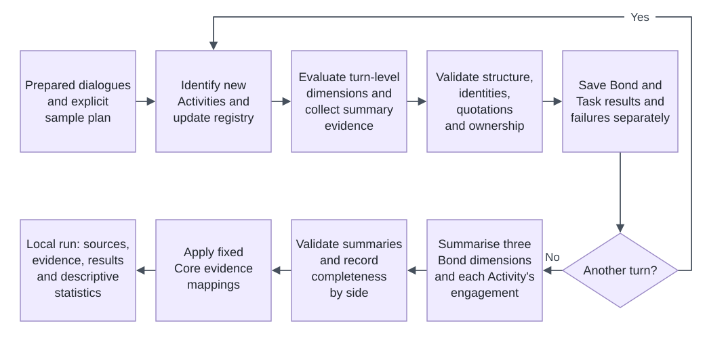

# Alliance Evaluation

A tool for evaluating Bond and Task in counselling dialogues. It identifies specific therapeutic work, records dimension-level textual evidence and categories for Bond and Task, and provides traceable result review. The method covers six Bond dimensions and eight Task dimensions; it does not calculate a total score.

**Terminology:** Bond and Task are core constructs. Activity (therapeutic activity) denotes specific work identified and tracked in a dialogue. Identifying an Activity does not establish agreement or the Task core.

## How it works



Activity identification and turn evaluation see only dialogue up to the current turn, without previous model ratings. Summary does not re-rate the other ten dimensions; rating evidence comes from validated turn evidence for the same target. Core mapping organises turn ratings and summary results without additional model scoring or separately mapping intermediate `evidence_only` records. Empty findings can be valid: they establish neither execution failure nor absence of an evaluable opportunity.

Read the [method definitions](framework/README.md) for the method and the [workflow guide](docs/README.md) for execution and saved records.

## Install and try without model calls

Python 3.11–3.13 is required. The pinned Pydantic version does not support Python 3.14 or later. Before creating the environment, check that `python3 --version` reports a supported version. If several versions are installed, use the supported interpreter (for example, `python3.13`) instead of `python3` in step 1. On Windows, `py -3.13` selects an installed Python 3.13 interpreter.

After downloading the source, follow these steps from the project root.

### 1. Create a virtual environment (first time only)

```bash
python3 -m venv .venv
```

### 2. Activate the virtual environment

macOS/Linux:

```bash
source .venv/bin/activate
```

On Windows PowerShell, use `.venv\Scripts\Activate.ps1`.

### 3. Install the project (first time only)

```bash
python -m pip install ".[app]"
```

CLI-only installation uses `python -m pip install .`; development and tests use `python -m pip install -e ".[app,dev]"`. Installed packages include prompts, schemas and demo resources, so execution need not remain in the source directory. Dependencies are in [pyproject.toml](pyproject.toml).

### 4. Start the App

```bash
alliance-eval app --workspace .
```

Keep the terminal running and open [http://127.0.0.1:8501](http://127.0.0.1:8501). The App listens locally; if the port is occupied, add `--port 8502` and open that port. Opening the App, selecting a provider and reading results make no model requests.

#### Stop, restart and check service status

Press **Ctrl+C** in the launch terminal to stop the App. Closing a browser tab does not stop the service; the page's top-right Stop control does not shut down the server either. If the terminal has returned to its prompt but the port is still occupied, use the management commands below.

Open another terminal in the project directory, activate the same virtual environment, then execute **only the command you need**.

Check whether the service is still running:

```bash
alliance-eval app status --workspace .
```

Stop the service:

```bash
alliance-eval app stop --workspace .
```

Restart the service; the new service stays running in this terminal:

```bash
alliance-eval app restart --workspace .
```

`alliance-eval app --workspace .` remains the launch command; `alliance-eval app start --workspace .` is equivalent. Management commands must use the same `--workspace` and `--port` as the launch command. The default port is 8501; for another port, for example, use `alliance-eval app stop --workspace . --port 8502`.

Normal stop waits up to ten seconds. On macOS/Linux it first requests graceful termination. After a timeout, and only when interruption of the current work is acceptable, use `alliance-eval app stop --workspace . --force`; restart also supports `--force`. Windows termination ends the process directly. Management verifies the current user, installation, workspace and port; it does not terminate another program merely because it occupies a port. Force does not bypass identity checks. Unverified processes and separately launched Streamlit applications are outside its management scope.

**Stopping or restarting interrupts an active evaluation.** Saved results remain, but an unfinished run may retain `running` status and is not resumed automatically. After restarting, refresh and recheck the selected settings, model and API key. Starting the service makes no model calls. `status` reports process state, not model availability or evaluation completion.

### 5. Run and inspect the demo in the App

Click **Run preset demo** in the sidebar. [Three original fictional dialogues and preset responses](examples/demo/README.md) pass through the same pipeline to create a new run with three samples, without a model or API key or overwriting an existing run. **It demonstrates the workflow and outputs, not model performance, expert annotations or a human gold standard.**

The new run is selected automatically. Switch `Sample` to explore `Dialogue & annotations`, `Summary` and `Core mapping`. Use `Validation details` when errors or completeness issues are present. Statistics category charts can cover the run or current sample; execution metrics always cover the whole run. Existing results can be selected under `Run` without rerunning the demo.

For subsequent sessions, activate the virtual environment and follow step 4; there is no need to create the environment or install the project again.

## Run your own data

1. Check and convert dialogues using the [input contract](docs/data-format.md). Supported structures include JSON/JSONL, CSV/TSV, XLSX and labelled TXT/Markdown transcripts. Roles, dialogue boundaries and turn order must be explicit; a supported extension does not imply arbitrary content is supported.
2. Place a prepared sample plan in the workspace's `data/plans/` and select it in the App. The App does not perform random, length-based or stratified sampling. **Skip `create-plan` when a usable plan already exists**; that helper only records already selected whole-dialogue IDs, or all dialogues when explicitly requested.
3. Configure DeepSeek, OpenAI, Mistral or Ollama using the [model guide](docs/models.md). Custom compatible connections can be registered in local `providers.json`. Check the runtime and inputs, then confirm data-processing permission and costs before calling a model. The CLI requires `--allow-model-calls`; clicking `Run All` in the App starts evaluation.
4. The App saves and reads results in the workspace's `runs/`. Follow the [review guide](docs/review.md) to check execution, source text, Activity ownership and evidence. Statistics report failed requests and valid result-category counts, not accuracy, overall quality or therapeutic outcomes.

The data workspace may be separate from the installation. Keep originals in `data/raw/`, converted files in `data/processed/`, plans in `data/plans/` and new results in `runs/`. Relative source paths resolve from the plan directory by default. The CLI accepts other plan paths and an explicit `--data-root`. A plan records what to run; it does not replace a study's sampling-method description.

## Project guide

```text
alliance-evaluation/
├── README.md / AGENTS.md       Usage entry point and Agent guide
├── pyproject.toml             Installation, dependencies and packaging
├── framework/                 Bond and Task definitions and evidence rules
├── prompts/                   Operational Activity / turn / summary prompts
├── schemas/                   Input contract and six model-output schemas
├── src/alliance_eval/          Shared pipeline, model interfaces, conversion, CLI and App
├── tests/                     Offline engineering tests
├── docs/                      Architecture, inputs, model configuration and review
├── examples/                  Original fictional input templates and preset demo
├── skills/                    Three optional prepare, run and review skills
├── .agents/skills/            Repository-relative links to the skill sources
├── .streamlit/config.toml      Local App configuration
├── data/                      Local raw / processed / plans
└── runs/                      Local run outputs
```

| What to understand | Documentation |
|:---|:---|
| Relationship between the method and implementation | [framework/](framework/README.md), [prompts/](prompts/README.md), [schemas/](schemas/README.md), [src/alliance_eval/](src/alliance_eval/README.md) |
| Input and output file conventions | [Input contract](docs/data-format.md), [data/](data/README.md), [runs/](runs/README.md) |
| Models and result checks | [Model configuration](docs/models.md), [result review](docs/review.md) |
| Examples, automated tests and Agent assistance | [examples/](examples/README.md), [tests/](tests/README.md), [skills/](skills/README.md), [AGENTS.md](AGENTS.md) |

The workflow does not depend on a particular Agent, skill or dataset. Run engineering tests with `python -m pytest -q`; they use original fixtures and block model network requests.

## Citation

Author: Yang Zou.

Zou, Y. (2026). *Alliance Evaluation* (Version 1.0.0) [Computer software]. GitHub. [https://github.com/ironmanzy520/alliance-evaluation](https://github.com/ironmanzy520/alliance-evaluation).

Also record the commit used, since different commits may share the same package version. The method's literature sources are listed in the [method definitions](https://github.com/ironmanzy520/alliance-evaluation/tree/main/framework).

## Data and use boundaries

Users must obtain permission to process data and separately confirm whether it may be sent to the chosen service. The tool does not verify source licences, anonymise data or repair source text. User data, real runs, credentials and local records do not belong in the source distribution. Retain inputs, original plans and conversion manifests alongside results: hashes do not replace files.

This fixed research implementation concerns textual evidence, not clinical diagnosis. Use and redistribution remain subject to applicable code and data licences.
